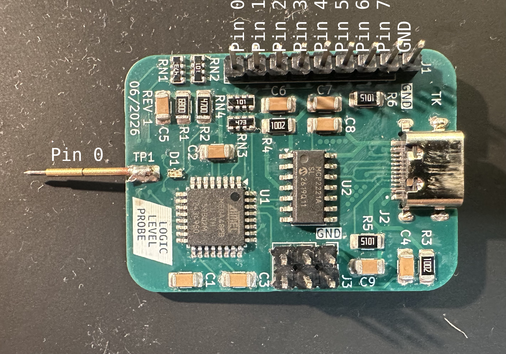
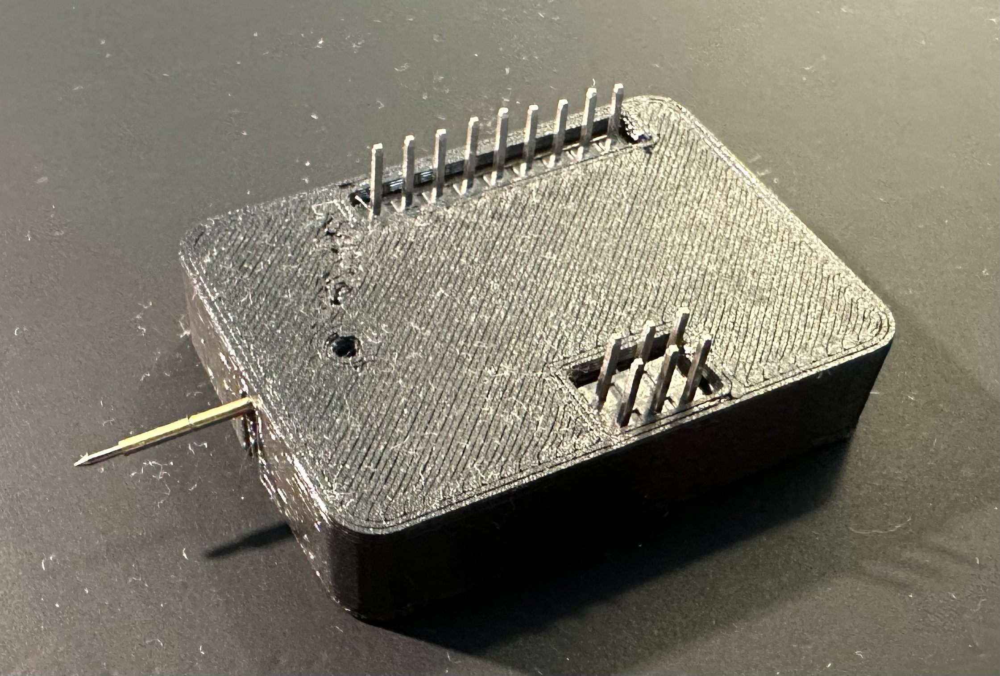

# logic level reader

A simple 8-pin 5V logic level reader with USB interface and.

Uses an ATmega48PB microcontroller for processing and an MCP2221A for making the ATmega's UART interface available over USB-C.

The ATmega is programmed using a USBasp using the 6-pin header and the Ardunio IDE (`logic_level_reader.ino`).

The device will periodically (every ~100ms) print the state of all pins (each line formatted as `<pin> <state>`,
where `pin` is the pin number (0 through 8), and `state` is `0=low`, `1=high`, or `2=floating`).
I haven't made a program yet that actually parses that data.

Pin 0 is connected to a pogo pin as well as the red-green LED.
For LOW, the red LED will light up, for HIGH, the green LED will light up, and for FLOATING, both will light up (resulting in an orange color).

The level sensing is done by first pulling the pin LOW (through 47k), then pulling it HIGH (also through 47k).
If the levels disagree, the pin is considered floating.

The pin closest to the USB port is GND and must be connected to the DUT's GND.

Note that this method of measuring can affect the DUT by pulling lines low/high!
Also, this doesn't work for high-frequency signals.
So, if you want to do some actual logic level analysis, you'd be better off using a proper logic level analyzer!

And the board probably wildly exceeds the allowed USB VBUS capacitance!

The PCB was designed in KiCAD and manufactured by JLCPCB.
Also, it's a 6-layer PCB because JLC had an offer back when I made this, so the PCB with ENIG and epoxy filled & capped vias only cost me <2€ (without shipping).
So, if you were to order this today, it'll probably cost somewhere in the neighborhood of 40€.

I also made a 3D printed case (PETG).

